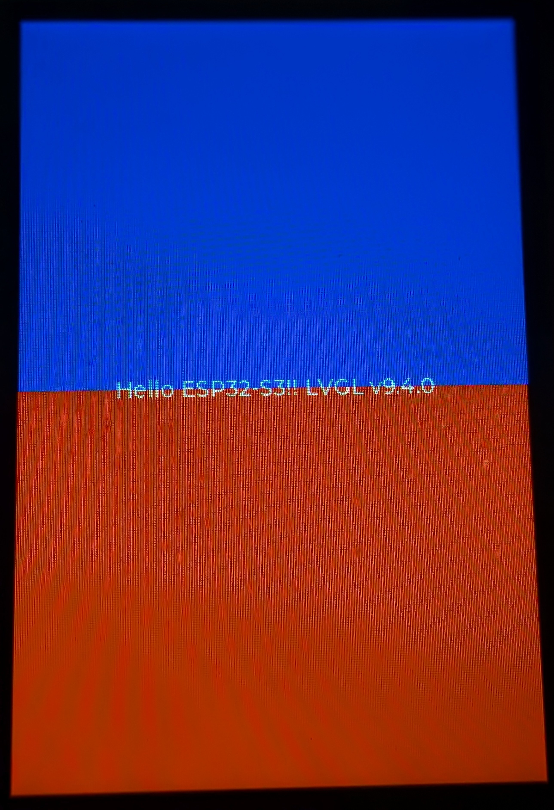

# Freenove FNK0104N Programs

MicroPython scripts for the [Freenove FNK0104N](https://store.freenove.com/products/fnk0104)
— an ESP32-S3 board with an onboard 3.5" 320x480 QSPI display (ST77922) that has an
integrated I2C capacitive touch controller.

Freenove only publishes an Arduino/C++ tutorial for this board's display and touch. Everything
display- or touch-related in this repo is a from-scratch MicroPython port of their C++
source (see `st77922.py` and `st77922_touch.py` for exactly which Freenove files each one is
ported from), running on the community
[lvgl_micropython](https://github.com/lvgl-micropython/lvgl_micropython) project instead of
stock MicroPython.



## Hardware

- Board: ESP32-S3-WROOM N8R8 (8MB flash, Octal PSRAM)
- Display: ST77922, 320x480, QSPI, portrait native orientation
- Touch: integrated capacitive controller on the display panel, but wired as its own,
  separate I2C peripheral (not exposed through the display's QSPI commands)
- Onboard extras: WS2812 (NeoPixel) RGB LED on GPIO 40. There is no plain onboard LED:
  GPIO 45 only goes to the "Extended IO" header (P3), so `led_blink.py` needs an external LED
  (see **External LED on GPIO 45** below)
- SD card (microSD, SDMMC 4-bit) and an ES8311 audio codec + speaker amp, for `music_player.py`

### Pin reference

| Function | Pins |
|---|---|
| Display (QSPI, SPI2_HOST @ 80MHz, mode 0) | `CS=10 BL=41(GPIO) SCLK=12 D0=11 D1=13 D2=14 D3=9` |
| Touch (I2C, addr `0x55`, 16-bit register addresses) | `SCL=39 SDA=38 RST=48 INT=47` |
| SD card (SDMMC, 4-bit)* | `CLK=5 CMD=4 D0=6 D1=7 D2=2 D3=3` |
| Audio: I2S to ES8311 DIN* | `BCK=18 WS=21 SD=15` (MCK=17 exists but is unused -- see `es8311.py`; used by `music_player.py`, `voice_recorder.py` and `rainbow_fade.py`) |
| Audio: I2S from ES8311 ADC (onboard MEMS mic)* | `DIN=16` (shares BCK/WS above; used by `voice_recorder.py`, `sound_meter.py` and `spectrum_analyzer.py`) |
| Audio: ES8311 control (I2C, addr `0x18`)* | `SCL=39 SDA=38` (shares the touch controller's bus) |
| Audio: speaker amp enable* | `GPIO 1` (active-LOW -- confirmed on hardware; docs.freenove.com didn't document polarity) |
| Onboard RGB LED (WS2812) | `GPIO 40` |
| Extended IO header (P3) | `1=3V3 2=GND 3=GPIO46 4=GPIO45` -- no onboard LED; wire an external one to GPIO 45 for `led_blink.py` |

\* SD card and audio pins are FNK0104N-specific values sourced from docs.freenove.com (see
`music_player.py`'s docstring for the exact chapter URLs) rather than from a Freenove source
file the way the display/touch pins were. Confirmed working on hardware; the one value
docs.freenove.com got wrong was the amp-enable pin's polarity (see `music_player.py`).

## Why a custom firmware is required

Stock MicroPython has no `lvgl` or `lcd_bus` modules. Scripts that touch the display
(`hello_world_display.py` and anything importing `st77922`/`st77922_touch`) require the
custom `lvgl_micropython` firmware built for this project — see **Firmware** below.
`led_blink.py`, `rgb_led_blink_fnk0104n.py`, and `music_player.py` (with `es8311.py`/
`wavplayer.py`) don't need it — they only use `machine.I2C`/`I2S`/`SDCard`/`Pin` and will run
on stock MicroPython too.

## Files

| File | Description |
|---|---|
| `hello_world_display.py` | Main display/touch demo. Shows a red-top/blue-bottom split screen; tapping either half toggles it between red and blue. |
| `touch_led_colors.py` | Divides the screen into 5 touch areas (red/green/blue/white/black); tapping one sets the onboard RGB LED to that color. |
| `touch_keyboard_demo.py` | On-screen touch keyboard (LVGL's built-in `lv.keyboard`/`lv.textarea`) in portrait. Confirms both widgets are compiled into this firmware. |
| `swipe_demo.py` | Swipe gesture test in portrait, using LVGL's built-in `lv.EVENT.GESTURE` / `get_gesture_dir()`. Shows the direction, changes color per direction and counts swipes. The screen's `SCROLLABLE` flag is removed, otherwise drags become scrolls and no gesture fires. |
| `swipe_demo_landscape.py` | Landscape version of `swipe_demo.py`, pairing `st77922.ST77922Landscape` with `st77922_touch.ST77922LTouch` so swipe directions match the landscape screen. |
| `seasons_fade.py` | Landscape slideshow of the pictures in `pictures/seasons`, fading each one in from black and back out. Swipe left/right to change picture. Draws the fade itself (viper) instead of through LVGL, which is too slow for full-screen fades; ~11 fps. Needs the pictures converted with `jpg_to_rgb565.py` and copied to `/seasons` on the board (see its docstring). |
| `seasons_fade_rtl.py` | Variant of `seasons_fade.py` where a soft-edged fade sweeps from right to left (fade-in reveals from the right edge; fade-out darkens from the right, the left edge fading last). Only rows that changed are sent, so it runs at ~30 fps. Uses the same `/seasons` pictures. |
| `touch_keyboard_demo_landscape.py` | Landscape version of `touch_keyboard_demo.py`, pairing `st77922.ST77922Landscape` with `st77922_touch.ST77922LTouch` (remaps raw physical touch coordinates into the landscape logical canvas). Known cosmetic issue: some keyboard control buttons (Enter, mode-switch, sometimes Backspace) briefly flash solid green -- see its docstring. |
| `ntp_clock.py` | WiFi + NTP-synced clock, rendered in landscape via `st77922.ST77922Landscape`. Shows Mountain Time (auto MST/MDT). Needs a real `wifi_secrets.py` (see below). |
| `wifi_secrets.py.example` | Template for `wifi_secrets.py` (gitignored) -- copy and fill in real WiFi `SSID`/`PASSWORD` before running `ntp_clock.py` or `voice_recorder.py` (the recorder still works without it, but names files `recNNN.wav`). |
| `music_player.py` | Plays a WAV file from the SD card over the onboard ES8311 codec/speaker; currently plays `demo1.wav` on run. Confirmed working end-to-end on hardware. Starting point for a future full SD-card music player. |
| `voice_recorder.py` | Touchscreen voice recorder (portrait): RECORD captures 10s from the onboard mic into RAM. Each recording is cleaned up in software (100Hz-4kHz band-pass, noise gate, normalization), then saved to the SD card as `rec_YYYYMMDD_HHMMSS.wav` (Mountain time, from one WiFi+NTP sync at startup via `local_time.py`; falls back to `recNNN.wav` if the sync fails). PLAY opens a scrollable list of the SD card's root `.wav` files; tapping one streams it from the card (44100Hz/16-bit PCM, mono or stereo). Each save is checked by reading back the file size; a failed save shows "Save failed", and the recording stays playable from the list as "(unsaved) last recording". With no card inserted, saving is skipped and PLAY replays the last recording from RAM. Confirmed working on hardware. |
| `sound_meter.py` | Live mic level meter: ~10s sweeping dBFS history graph (`lv.chart`) plus a VU bar with peak hold, in portrait. Touch is never initialized (its I2C polling would put clicks into the mic). The spectrum view is a separate program, `spectrum_analyzer.py`. |
| `spectrum_analyzer.py` | Live mic spectrum analyzer (portrait): 32 log-spaced bars from 86Hz to 16kHz, with peak-hold caps, from a 2048-point fixed-point FFT (`@micropython.viper`, Hann window) run 10 times a second. The bars are drawn into their own pixel buffer and sent straight to the panel, bypassing LVGL, which was too slow for them (see its docstring for the measurements). The scale runs -20 to -80 dB relative to a full-scale sine. Touch is never initialized, as in `sound_meter.py`. Confirmed working on hardware. |
| `rainbow_fade.py` | The whole screen fades smoothly through the rainbow (red, orange, yellow, green, cyan, blue, indigo, violet) and back again. It eases to a stop at each end, and one pass takes 30s (`SECONDS_PER_PASS`). A sine tone through the speaker follows the color: 220Hz at red up to 880Hz at violet, with the volume tapering down as the pitch rises (`TONE_*` settings). Both are drawn and generated directly (viper), not through LVGL. Each repaint is spread over a few ticks, because one long screen write starved the audio and caused static (see `CLAUDE.md`). `stop()` at the REPL silences the tone. Touch isn't used. Confirmed working on hardware. |
| `local_time.py` | Helper module: WiFi connect (`wifi_secrets.py`), NTP sync, and Mountain Time (US DST rules). Copied from `ntp_clock.py`; used by `voice_recorder.py`. |
| `es8311.py` | I2C driver for the ES8311 audio codec, ported from raptor09010's `Micropython-ES8311-Library`. Playback, plus mic/ADC input via `enable_mic()`. Used by `music_player.py`, `voice_recorder.py`, `sound_meter.py`, `spectrum_analyzer.py` and `rainbow_fade.py`. |
| `wavplayer.py` | Non-blocking WAV-over-I2S player, from Mike Teachman's `micropython-i2s-examples` (via the same ES8311 library repo above). |
| `mp3_to_wav.py` | **PC-side tool**, not a board script. Converts an MP3 to a 16-bit PCM WAV (this firmware has no MP3 decoder) using `miniaudio`; run with the project's `.venv`. |
| `jpg_to_rgb565.py` | **PC-side tool**, not a board script. Converts images to raw RGB565 files scaled to 480x320 and pre-rotated for landscape, for `seasons_fade.py`. Uses Pillow; run with the project's `.venv`. |
| `demo1.mp3` / `demo1.wav` | Sample track. The `.wav` (produced by `mp3_to_wav.py`) is what actually gets copied to the SD card and played. |
| `screenshot.jpg` | Photo of `hello_world_display.py` running on the board. |
| `st77922.py` / `_st77922_init.py` | ST77922 QSPI display driver, ported from Freenove's `ST77922.h`/`.cpp`. `_st77922_init.py` holds the panel init command table. Also has `ST77922Landscape`, a from-scratch software-rotation variant used by `ntp_clock.py` (see its docstring). |
| `_st77922landscape_init.py` | Thin re-export of `_st77922_init.py`'s init table, required only because `display_driver_framework.DisplayDriver.init()` picks up the init module by class name (`ST77922Landscape` needs its own `_st77922landscape_init` module to be found at all) -- the actual init sequence is identical to `ST77922`'s. |
| `st77922_touch.py` | I2C driver for the display's integrated touch controller, ported from Freenove's `ST77922_Touch.h`/`.cpp`. Also has `ST77922LTouch`, which remaps raw touch coordinates for use with `st77922.ST77922Landscape` (used by `touch_keyboard_demo_landscape.py`). |
| `bme280.py` | I2C driver for a Bosch BME280 temperature/humidity/pressure sensor on the "I2C" header (P4: 1=3V3 2=GND 3=SCL/GPIO39 4=SDA/GPIO38; CSB to 3V3, SDO to GND for address 0x76). `read()` returns degC/hPa/%RH, `read_f()` degF/inHg/%RH. Uses Bosch's integer compensation code. Works with `machine.I2C` or the touch driver's shared `i2c.I2C.Bus`. Confirmed working on hardware. |
| `bme280_display.py` | Shows the BME280's readings on the display (portrait), refreshed every 2s: temperature in °F (with °C and the session's low/high), relative humidity, and pressure in inHg/hPa. Set `ALTITUDE_M` to show sea-level pressure instead of station pressure. Needs `bme280.py`. Touch isn't used. |
| `led_blink.py` | Blinks an **external** LED on GPIO 45 (the board has no plain onboard LED; see **External LED on GPIO 45**). No firmware/display dependency. |
| `rgb_led_blink_fnk0104n.py` | Cycles the onboard WS2812 RGB LED (GPIO 40) through red/green/blue. No firmware/display dependency. |
| `firmware/lvgl_micropy_ESP32_GENERIC_S3-SPIRAM_OCT-8.bin` | The custom-built firmware binary (see below). |

None of these scripts auto-run on boot — there's no `main.py`/`boot.py`. Run them manually
from the REPL (`import hello_world_display`, etc.).

`music_player.py` also needs `demo1.wav` copied to the root of a microSD card inserted in the
board (fastest via a card reader, not WebREPL/serial — it's ~4.7MB), and `es8311.py` /
`wavplayer.py` pushed alongside it like any other loose file.

### External LED on GPIO 45

Freenove's 3.5" schematic (`Schematic/3.5inch_ESP32-S3_Display_Schematic.pdf` in
[Freenove_ESP32_S3_Display](https://github.com/Freenove/Freenove_ESP32_S3_Display)) has no
LED on GPIO 45. The pin only goes to pin 4 of the 4-pin "Extended IO" header (P3). To run
`led_blink.py`, wire an LED there:

```
P3 pin 4 (GPIO 45) ──[ 220–330Ω ]──►|── P3 pin 2 (GND)
                                  LED (anode → resistor, cathode → GND)
```

Wire the LED to GND as shown (active-high), not to 3V3. GPIO 45 is an ESP32-S3 strapping
pin that sets the flash voltage at reset. It has to be low at boot, and an LED wired to 3V3
could pull it high and stop the board from booting.

`st77922_touch.py` was also verified against Sitronix's own register-level protocol spec for
the touch controller (pulled from Freenove's GitHub repo's `Datasheet/` folder), kept locally
as `Datasheet/ST77922_TDDI_Interface_Protocol_V01.00.pdf` but **not committed to this repo**
— it's marked confidential by Sitronix, so `.gitignore` excludes it.

## Installing mpremote

`mpremote` is how files get onto the board and scripts get run. It's a Python package:

1. Install Python 3 from python.org. On Windows, tick **"Add python.exe to PATH"** in the
   installer.
2. `pip install mpremote` (or `pipx install mpremote`).
3. Check it: `mpremote --version`, then `mpremote devs` with the board plugged in. The board
   shows up as VID:PID `303A:4001`.

The COM port number differs per computer: COM12 in the commands below is just this PC's.
Windows needs no extra driver (the ESP32-S3's built-in USB uses the standard USB serial
driver). If the port is busy, close any other serial monitor, Thonny, or IDE console using it.
If `mpremote` isn't found after installing, Python's Scripts folder isn't on PATH;
`python -m mpremote ...` works the same.

## Firmware

Built from a clone of `lvgl_micropython` (WSL Ubuntu), with:

```
python3 make.py esp32 BOARD=ESP32_GENERIC_S3 BOARD_VARIANT=SPIRAM_OCT DISPLAY=st77922
```

Flash `firmware/lvgl_micropy_ESP32_GENERIC_S3-SPIRAM_OCT-8.bin` with `esptool` at 460800
baud. The board has no auto-reset circuitry on its native USB port, so flashing needs manual
BOOT+RESET into download mode — and it enumerates on a *different* COM port in bootloader
mode vs. running firmware.

`st77922.py`, `_st77922_init.py`, and `st77922_touch.py` are plain files on the board's
filesystem, not frozen into the firmware binary — MicroPython loads the filesystem copy over
any same-named module frozen into firmware, so iterating on them is just a matter of editing
here and re-pushing (e.g. via `mpremote cp <file> :`) — no firmware rebuild needed. A
rebuild is only required to change something genuinely baked into firmware (board config,
frozen framework modules, etc).

## Flashing MicroPythonOS

`firmware/mpos_fnk0104n_*.bin` is a single merged image. It goes into the ESP32-S3's internal
flash at offset `0x0` over USB, not onto an SD card. Use the newest file in `firmware/`.

**Download mode.** The MPOS image uses TinyUSB on the native USB port, so auto-reset doesn't
work. Hold **BOOT**, tap **RESET**, then let go of BOOT. In download mode the board shows up on
a different COM port than when it's running (COM11 vs. COM12 on the development PC; check
Device Manager or `python -m serial.tools.list_ports` on another machine). After flashing,
press **RESET** if the board doesn't start on its own.

**Erasing.** Erase the whole flash on a new board, or when coming from another firmware
(plain MicroPython, the `lvgl_micropython` image above). Skip the erase when updating one MPOS
image to another, so the installed apps and the WiFi settings are kept.

Any of these Windows tools will work:

1. **esptool** (command line; what this project uses):

   ```
   pip install esptool
   esptool --chip esp32s3 --port COM11 --baud 460800 --before no-reset --after watchdog-reset write-flash --erase-all 0x0 firmware\mpos_fnk0104n_2026-11-09e_weather.bin
   ```

   Leave out `--erase-all` to keep the filesystem. Use `--after watchdog-reset`: after a
   manual download-mode entry, the default `hard-reset` doesn't leave the bootloader.
2. **ESP Web Flasher** (browser, nothing to install): open
   <https://espressif.github.io/esptool-js/> in Chrome or Edge (needs Web Serial), click
   Connect and pick the download-mode port, click "Erase Flash" if needed, add the `.bin` at
   address `0x0`, then click Program.
3. **Espressif Flash Download Tool** (Windows GUI): choose chip **ESP32-S3** and mode
   **Develop**, add the `.bin` at `0x0`, set SPI mode DIO and flash size 8MB, click ERASE if
   needed, then START.
4. **Thonny**: Tools → Options → Interpreter → "Install or update MicroPython (esptool)",
   then pick the local `.bin`. It runs esptool underneath, with fewer options.

After a full erase: connect WiFi again in Settings, reinstall the apps (see below), and enter
a zip code in Weather Zip. Until then the top bar shows `--°F`.

## MicroPythonOS apps

`mpos_apps/` holds apps for the MicroPythonOS image (`firmware/mpos_fnk0104n_*.bin`, runs on
COM12). Each app is a folder named after its `fullname` with a `MANIFEST.JSON` (name,
entrypoint, Activity class name, launcher intent filter), the entrypoint `.py` (an
`mpos.Activity` subclass), and `icon_64x64.png`. `com.eric.template` is a minimal starting
point: a button, a tap counter, and a timer that only runs while the app is in the foreground
(created in `onResume`, deleted in `onPause`).

`com.eric.weatherzip` (Weather Zip) sets the US zip code for the top bar's outside
temperature. It looks the zip up on zippopotam.us and saves the zip, latitude, longitude and
place name in the `com.eric.weatherzip` preferences. The top bar module
(`fnk0104n_topbar.py`, part of the MicroPythonOS firmware build) reads them and fetches the
temperature from open-meteo.com every 15 minutes. Neither service needs an API key.

Install or update an app with Windows `mpremote` (wait until MPOS has finished booting):

```
mpremote connect COM12 fs mkdir :/apps          # only once; errors if it exists
mpremote connect COM12 fs cp -r mpos_apps/com.eric.template :/apps/
mpremote connect COM12 reset
```

Don't run MPOS's `install.sh` with no arguments: it copies `lib/` and `builtin/` over the
frozen copies.

## Known limitations

- **No MP3 decoding on-device.** This firmware has no MP3 decoder (MicroPython/ESP32 doesn't
  ship one, and this project's build doesn't bundle one). `mp3_to_wav.py` decodes MP3s to WAV
  on the PC instead; real on-device MP3 decoding would need a native C decoder (e.g.
  libhelix-mp3) added to the firmware build.
- **Hardware (MADCTL) rotation is not implemented**, and LVGL's own software-rotation path is
  compiled out of this firmware build (`LV_DRAW_TRANSFORM_USE_MATRIX=0`) -- see
  `st77922.py`'s `ST77922Landscape` class docstring for how both were ruled out by reading the
  actual firmware source. `ST77922Landscape` (used by `ntp_clock.py`) instead does its own
  from-scratch software pixel-shuffle per flush, the same general idea as Freenove's own
  `Fill_Colors()` workaround but written independently -- **confirmed working correctly on
  hardware.** Getting there also required working around a real panel limitation (this ST77922
  cannot handle a narrow-CASET/full-RASET window write at all, regardless of how it's driven)
  and a large performance fix (a pure-Python per-pixel rotation loop was taking ~8 seconds per
  chunk); see `CLAUDE.md`'s "Display driver architecture" section for the full writeup.
- **Multi-touch is not implemented.** The touch controller reports multiple contact points,
  but `st77922_touch.py` only reads and uses the first one (sufficient for single-touch
  tap/click use, which is all `hello_world_display.py` needs).
- **Hard-reset the board (physical RESET button / power-cycle) after any script run that
  raises an exception or is interrupted before finishing**, not just after editing code. The
  display's QSPI bus and `esp_lcd` panel-IO handle are native ESP-IDF resources that aren't
  freed by a soft-reset/re-run alone — an aborted run can leave enough of the board's small
  internal (non-PSRAM) DMA-capable memory pool allocated that the *next* run's display init
  fails with `ESP_ERR_NO_MEM` even though the code itself is fine.
